# HY320 Mini mais rápido, sem trocar o sistema

Scripts, tutorial e skills do Claude Code para deixar o projetor **HY320 Mini** (Allwinner H713, Android 11) mais rápido e mais leve pela rede Wi‑Fi, usando ADB a partir de um PC com Windows.

Nada é apagado nem regravado: os apps são compilados, os serviços desnecessários do fabricante são **desativados** (não desinstalados) e tudo pode ser desfeito com um comando.

| Tela inicial original | Depois, com o Projectivy (opcional) |
|---|---|
| 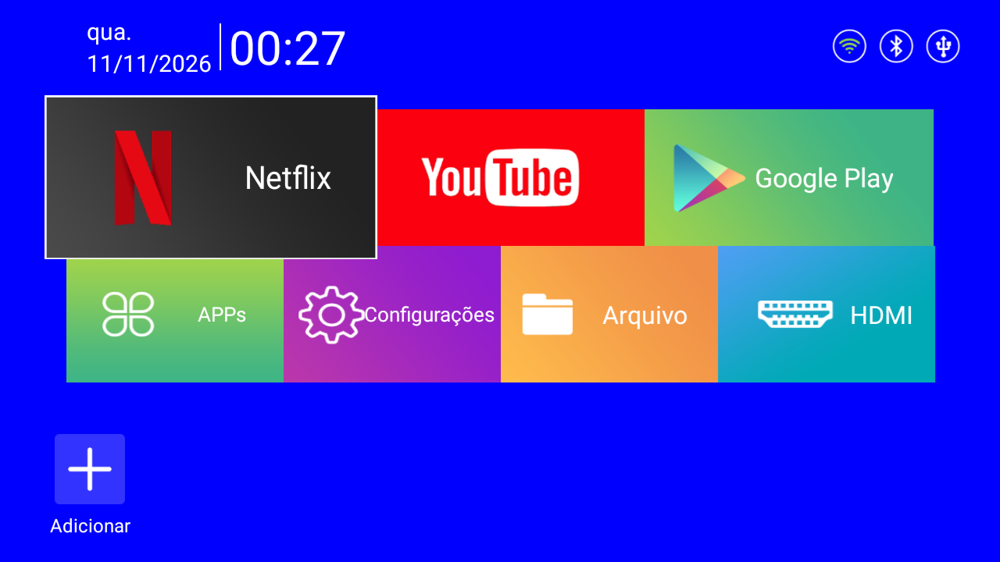 | 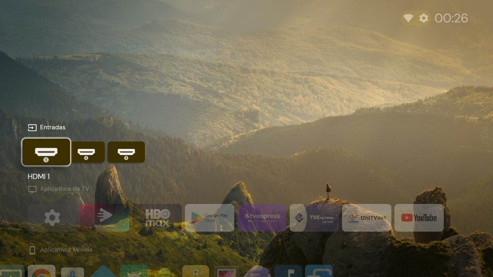 |

> **Resultado em um aparelho real.** Depois da otimização, o dono do projetor notou uma melhora de velocidade de **235%** no uso do dia a dia. Em números medidos no aparelho: **93 apps em código nativo** (eram 6), **animações com metade da duração**, **69 MB de memória devolvidos** e **nenhum serviço do fabricante** rodando em segundo plano. Os prints estão em [Resultado](#resultado).

**Nunca fez isso antes?** Há dois caminhos para iniciantes: deixar o [Claude Code conduzir tudo](#jeito-mais-fácil-com-o-claude-code), ou seguir o [tutorial passo a passo](TUTORIAL.md) por conta própria.

## Índice

- [Jeito mais fácil: com o Claude Code](#jeito-mais-fácil-com-o-claude-code)
- [Resultado](#resultado)
- [Como usar sem o Claude Code](#como-usar-sem-o-claude-code)
- [O que o script faz](#o-que-o-script-faz)
- [Como desfazer](#como-desfazer)
- [Bloqueio de anúncios](#bloqueio-de-anúncios)
- [Apps de streaming](#apps-de-streaming)
- [O aparelho fica lento de propósito?](#o-aparelho-fica-lento-de-propósito)
- [Segurança](#segurança)
- [Limitações](#limitações)
- [Dá para instalar outro sistema?](#dá-para-instalar-outro-sistema)
- [Para agentes de IA](#para-agentes-de-ia)
- [Arquivos](#arquivos)

## Jeito mais fácil: com o Claude Code

O repositório traz uma skill que transforma o [Claude Code](https://claude.com/claude-code) em um guia: ele instala o que falta no computador, diz o que apertar no controle do projetor, encontra o aparelho, pergunta suas preferências, aplica tudo e confere o resultado. Você não digita nenhum comando além dos três abaixo.

1. **Instale o Claude Code.** No Windows, abra o PowerShell e cole:

   ```powershell
   irm https://claude.ai/install.ps1 | iex
   ```

   Ele exige uma conta Claude paga (Pro, Max, Team ou Enterprise) ou uma conta da API. Quem preferir pode usar o [aplicativo de desktop](https://claude.com/download) no lugar do terminal.

2. **Baixe este repositório** (botão verde **Code** → **Download ZIP**), extraia e abra o PowerShell dentro da pasta: clique na barra de endereço do Explorador de Arquivos, digite `powershell` e aperte Enter.

3. **Inicie o Claude Code e peça:**

   ```text
   claude
   ```

   ```text
   /configurar-projetor
   ```

   Também funciona escrever com suas palavras, por exemplo "configure meu projetor".

O que esperar:

- O Claude Code pede sua permissão antes de rodar comandos no computador. Pode aprovar os que ele explicar.
- A sua parte é só no projetor: ligar a "Depuração USB" seguindo as instruções dele, aceitar um aviso na tela e reiniciar quando ele pedir.
- Leva cerca de 30 minutos, quase tudo de espera.
- Para desfazer depois, abra o Claude Code na mesma pasta e peça "desfaça a otimização do projetor".

O que o Claude Code encontra nesta pasta:

| Arquivo | O que ele ensina ao Claude |
|---|---|
| [CLAUDE.md](CLAUDE.md) | As regras que valem sempre: conferir o aparelho, só mudanças reversíveis, nada de firmware |
| [configurar-projetor](.claude/skills/configurar-projetor/SKILL.md) | O roteiro completo para conduzir um leigo, do zero ao projetor otimizado |
| [otimizar-projetor-android](.claude/skills/otimizar-projetor-android/SKILL.md) | O conhecimento técnico: como analisar, medir e otimizar, e as armadilhas já encontradas |

## Resultado

Tudo nesta seção vem de um HY320 Mini com o firmware `HY320mini_Android11_202506182038`. As imagens de terminal mostram a saída real dos comandos, rodados no projetor em 12/11/2026.

### O que o dono notou

Logo depois de reiniciar o projetor otimizado, o dono relatou que ele estava "muito mais rápido" e estimou a melhora de velocidade em **235%**: menus que respondem na hora, apps que abrem sem engasgar e troca de telas mais curta.

Esse número é a percepção de quem usa o aparelho todos os dias, não a leitura de um cronômetro. As medições abaixo mostram de onde ela vem.

### O que foi medido

| O que foi medido | Antes | Depois |
|---|---|---|
| Apps compilados para código nativo (`speed`) | 6 | 93 |
| Apps só verificados, rodando interpretados (`verify`) | 89 | 6 |
| Duração das animações da interface | 1.0x | 0.5x (metade do tempo) |
| Memória dos serviços do fabricante sempre ativos | 44 MB | 0 (nenhum processo) |
| Memória do Bluetooth ligado sem uso | 25 MB | 0 |
| Log de depuração do Wi‑Fi | gravando a cada 3 s | desligado |
| Endereços de anúncio e rastreamento bloqueados (de 101 testados) | 0 | 91 (opcional) |

O aparelho tem só 954 MB de RAM, então cada dezena de megabytes conta. Os valores de memória são por processo; o total usado pelo sistema não entra na tabela porque depende de quais apps estão abertos no momento da medição.

### Apps em código nativo

De fábrica, 89 apps ficam apenas "verificados": o Android precisa interpretar o código deles toda vez que rodam. O script compila tudo para código nativo.

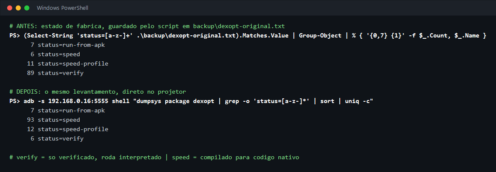

Os 6 que continuam em `verify` são pacotes desativados (os testes de fábrica e o NFC) e apps que o script deixa para o Android compilar aos poucos, conforme o uso, como a Play Store e o Chrome.

### Abertura dos apps

Na avaliação do dono do aparelho, cada um destes apps passou a abrir **mais de 75% mais rápido** depois da otimização:

| App | Melhora percebida pelo dono |
|---|---|
| Configurações | mais de 75% |
| Gerenciador de arquivos | mais de 75% |
| Galeria | mais de 75% |
| Música | mais de 75% |
| Tela inicial original | mais de 75% |

Esses valores são a percepção de quem usa o projetor, não a leitura de um cronômetro. Na medição feita com o próprio Android (`am start -W`, 5 aberturas a frio de cada app, antes e depois), a diferença foi de 2% a 8%. Esse teste isola uma coisa só, abrir um app parado com o aparelho ocioso, e não captura a duração das transições (que caiu pela metade), a rolagem dos menus nem o efeito de ter mais memória livre e nenhum serviço do fabricante disputando o processador.

Para repetir a medição no seu aparelho: [ferramentas/medir-abertura.sh](ferramentas/medir-abertura.sh). Os dados brutos estão em [docs/medicao-abertura.txt](docs/medicao-abertura.txt).

### Serviços do fabricante desligados

A loja de apps do fabricante, três atualizadores automáticos, três testes da linha de produção e a pilha de impressão ficam desativados, e nenhum processo deles roda mais.

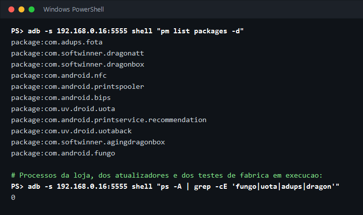

O `com.android.nfc` já vem desativado de fábrica; os outros dez foram desativados pelo script.

### Ajustes do sistema

Animações em metade do tempo, Bluetooth iniciando desligado e a nova tela inicial em uso.

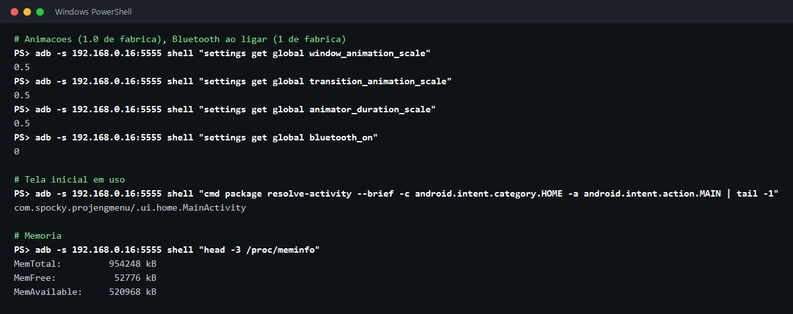

### Anúncios bloqueados

Com a opção de bloqueio ligada, os endereços de redes de anúncio e rastreamento deixam de existir para o projetor, e o conteúdo continua funcionando. O teste abaixo tenta 101 endereços conhecidos de anúncio: o serviço usado na primeira versão bloqueava 72, o nível forte de agora bloqueia 91, sem quebrar nenhum dos 44 endereços de que os apps precisam.

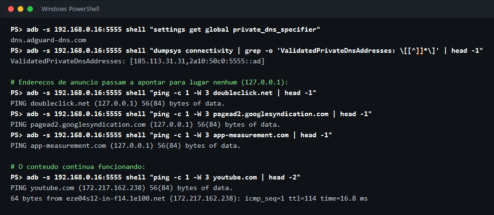

Para as páginas da internet há uma segunda camada: o navegador TV Bro, com bloqueador próprio. Com as duas ligadas, a página AdBlock Tester deu 97 de 100 pontos no projetor.

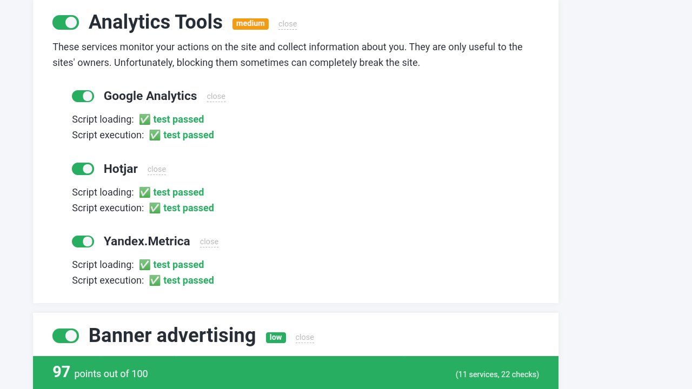

Os anúncios do app do YouTube e os intervalos dos planos de streaming com anúncios continuam. O motivo e as alternativas estão em [Bloqueio de anúncios](#bloqueio-de-anúncios).

### Apps de streaming funcionando

Prime Video, Paramount+ e HBO Max instalados pela Play Store do projetor e abrindo normalmente depois da otimização. A Netflix também abre, mas bloqueia captura de tela, por isso não aparece aqui.


## Como usar sem o Claude Code

Resumo para quem já conhece ADB. O passo a passo completo, com imagens de cada tela, está no [TUTORIAL.md](TUTORIAL.md).

1. Instale o ADB: `winget install Google.PlatformTools`
2. No projetor, ative **Depuração USB** em `Configurações > Preferências do dispositivo > Opções do desenvolvedor`.

   | Preferências do dispositivo | Opções do desenvolvedor | Depuração USB ligada |
   |---|---|---|
   | 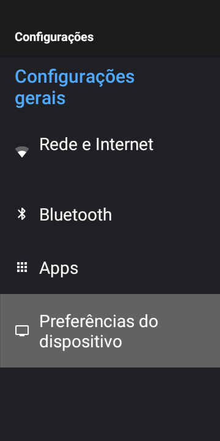 | 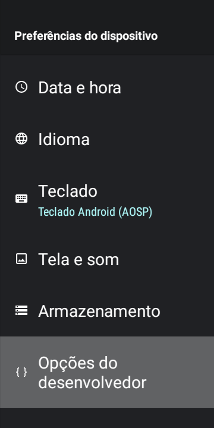 | 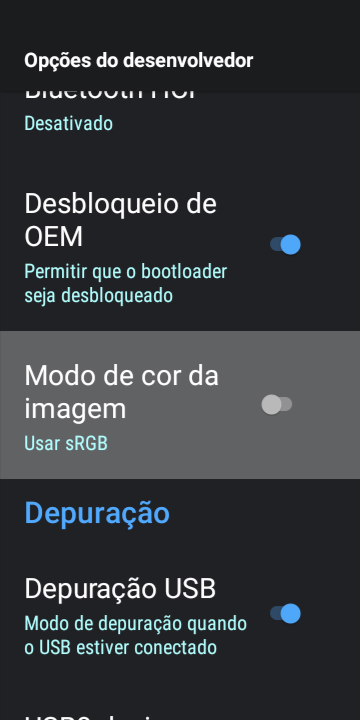 |

3. Descubra o IP do projetor e rode a otimização:

   ```powershell
   Set-ExecutionPolicy -Scope Process Bypass -Force
   .\encontrar-projetor.ps1
   .\otimizar-hy320.ps1 -Ip 192.168.0.15 -Completo
   ```

   A busca mostra o projetor e avisa quando encontra outro aparelho Android que não deve ser alterado:

   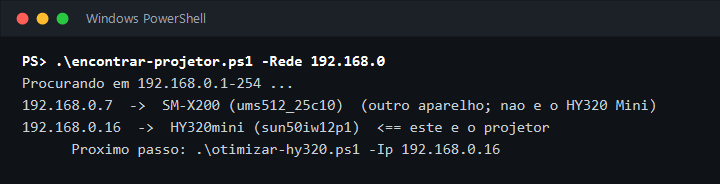

4. Reinicie o projetor e **desligue a Depuração USB**.

## O que o script faz

| Etapa | O que muda | Por quê |
|---|---|---|
| Trava de segurança | Confere se o aparelho é mesmo um HY320 Mini antes de qualquer alteração | Evita mexer em outro Android da rede (celular, tablet) |
| Backup | Salva ajustes, lista de pacotes e estado de compilação em `backup/` | Permite conferir e restaurar o estado original |
| Compilação | Compila os apps para código nativo (`speed`) | De fábrica, quase tudo roda interpretado |
| Pacotes sem uso | Desativa três ferramentas de teste da linha de produção e a pilha de impressão do Android | Não têm uso em um projetor; o serviço de impressão sobe em todo boot |
| Animações | Reduz para 0.5x | A interface responde mais rápido |
| Log de Wi‑Fi | Desliga o log verboso | Gravava no log a cada 3 segundos |

### Opções

Estas têm uma contrapartida, por isso são opcionais. `-Completo` liga as quatro primeiras.

| Opção | O que faz | Contrapartida |
|---|---|---|
| `-BloquearAnuncios` | Bloqueia endereços de anúncio e rastreamento no sistema inteiro, pelo DNS privado do Android | Não remove anúncios dentro do YouTube. As consultas de DNS do projetor passam a ir para o serviço de bloqueio. Veja [Bloqueio de anúncios](#bloqueio-de-anúncios) |
| `-NivelBloqueio forte`, `maximo` ou `padrao` | Escolhe a força do bloqueio. Sem esta opção vale `forte` | `maximo` bloqueia também o "Entrar com Facebook" e pode quebrar um ou outro site; `padrao` bloqueia menos |
| `-DesativarFabricante` | Desativa a loja de apps do fabricante e os atualizadores automáticos | O projetor deixa de receber atualizações do fabricante. A Play Store continua funcionando |
| `-DesligarBluetooth` | O Bluetooth passa a iniciar desligado | Para usar, ligue nas Configurações. O Android lembra o último estado: se reiniciar com ele ligado, volta ligado |
| `-InstalarProjectivy` | Instala o [Projectivy Launcher](https://github.com/spocky/miproja1) como tela inicial | Mais organizado, porém usa mais memória que a tela original (87 MB contra 42 MB) |
| `-Desativar pkg1,pkg2` | Desativa outros pacotes que você indicar | Por sua conta |
| `-PularCompilacao` | Pula a compilação dos apps | Útil só para reaplicar ajustes |
| `-AceitarModelo` | Aceita outro modelo com o mesmo chip do HY320 Mini (`sun50iw12p1`), como o HY300 Pro | O roteiro foi testado só no HY320 Mini. Prefira o modo básico, sem `-Completo`. Pacotes que não existirem no firmware são pulados com um aviso |

### Exemplo de saída

```text
PS> .\otimizar-hy320.ps1 -Ip 192.168.0.15 -Completo
Projetor confirmado: HY320mini (sun50iw12p1) em 192.168.0.15:5555
Backup do estado original salvo em .\backup
Animacoes em 0.5x e log verboso de Wi-Fi desligado
Bluetooth ficara desligado a partir do proximo reinicio
Bloqueio de anuncios ativo (x-hagezi-proplus.freedns.controld.com). Teste: PING doubleclick.net (127.0.0.1) 56(84) bytes of data.
Para contar quantos enderecos de anuncio ele bloqueia: ferramentas\testar-bloqueio.sh
Desativado: com.softwinner.dragonbox
Desativado: com.softwinner.agingdragonbox
Desativado: com.softwinner.dragonatt
Desativado: com.android.printspooler
Desativado: com.android.bips
Desativado: com.android.printservice.recommendation
Desativado: com.android.fungo
Desativado: com.uv.droid.uota
Desativado: com.uv.droid.uotaback
Desativado: com.adups.fota
Projectivy definido como tela inicial (conclua a tela de boas-vindas no projetor)
[1/103] android: Success
[2/103] android.auto_generated_rro_product__: Success
...
[98/103] com.softwinner.tvvolume: Success
[99/103] com.softwinner.vis: Success
...
Concluido. Reinicie o projetor e, depois, desligue a Depuracao USB nas opcoes do desenvolvedor.
```

A compilação leva pouco mais de 10 minutos e o projetor fica lento enquanto ela roda.

## Como desfazer

```powershell
.\restaurar-hy320.ps1 -Ip 192.168.0.15
```

Reativa todos os pacotes desativados, volta as animações, o log de Wi‑Fi, o Bluetooth, o DNS e a tela inicial original. Opções extras:

- `-RemoverProjectivy` também desinstala o Projectivy.
- `-ResetCompilacao` também descarta a compilação nativa dos apps.

## Bloqueio de anúncios

Nenhum bloqueador sozinho bloqueia tudo. O que este repositório faz é somar duas camadas, e deixar claro o que fica de fora. A explicação completa, com a comparação entre os métodos e como o navegador Brave funciona, está em [docs/bloqueio-de-anuncios.md](docs/bloqueio-de-anuncios.md).

**Camada 1: o sistema inteiro.** A opção `-BloquearAnuncios` não instala nenhum app. Ela liga o **DNS privado** do Android (DNS criptografado, por TLS) apontando para um serviço que recusa endereços de redes de anúncio e rastreamento. As listas de bloqueio ficam no servidor e são atualizadas por ele; no projetor o custo de memória é zero. São três níveis, escolhidos com `-NivelBloqueio`:

| Nível | Serviço | Bloqueados no teste (de 101) |
|---|---|---|
| `forte` (padrão) | [Control D](https://controld.com/free-dns) com a lista [HaGeZi Pro++](https://github.com/hagezi/dns-blocklists) | 91 no projetor |
| `maximo` | Control D com a lista HaGeZi Ultimate | um pouco mais que o `forte` (95 contra 93 na comparação feita pelo PC); bloqueia também o "Entrar com Facebook" |
| `padrao` | [AdGuard DNS](https://adguard-dns.io/) | 72 no projetor |

No nível `forte`, o teste no projetor bloqueou os 18 endereços de anúncios dentro de apps (Unity Ads, AppLovin, Vungle e outros), os 21 de anúncios em sites, 12 de 13 do Google, 9 de 11 de pop-ups, 19 de 24 rastreadores e 12 de 14 de TVs e fabricantes. Os 44 endereços de que os apps precisam continuaram funcionando, e YouTube, Netflix, Prime Video, HBO Max e Paramount+ abriram normalmente. Para repetir a contagem no seu aparelho: [ferramentas/testar-bloqueio.sh](ferramentas/testar-bloqueio.sh).

**Camada 2: as páginas da internet.** O Brave bloqueia mais que um DNS porque trabalha dentro do navegador, onde enxerga o endereço completo de cada pedido e a página montada. A Play Store do projetor recusa o Brave, mas aceita o [TV Bro](https://github.com/truefedex/tv-bro), um navegador de código aberto feito para controle remoto, com bloqueador por lista de filtros já ligado. Instale pela Play Store do projetor (procure "TV Bro") ou peça ao Claude Code. Ele não roda em segundo plano.

**O que fica de fora:**

- **Anúncios do app do YouTube.** Eles vêm dos mesmos servidores dos vídeos, e nenhum bloqueio de rede consegue separá-los. Só um app alternativo de YouTube resolve, e ele não está na Play Store; veja [o que pesar antes](docs/bloqueio-de-anuncios.md#youtube).
- **Planos de streaming com anúncios.** O intervalo comercial é parte do próprio vídeo.

O que saber antes de ligar:

- **Privacidade.** As consultas de DNS do projetor passam a ir para o serviço escolhido (Control D ou AdGuard) em vez da sua operadora.
- **Se um app parar de funcionar** com o nível `forte`, rode o script de novo com `-BloquearAnuncios -NivelBloqueio padrao -PularCompilacao`.
- **Teste automático.** O script confere se a conexão com o DNS validou. Se o nível escolhido não validar, ele tenta o AdGuard DNS; se a rede bloquear a porta 853, desfaz a mudança sozinho e avisa.
- **Relógio.** O DNS privado só funciona com a data certa. Para o caso de o relógio zerar por falta de energia, o script também aponta o servidor de hora por endereço IP, que não depende de DNS. Esse cenário (projetor fora da tomada por muito tempo) não foi testado na prática.
- **Se o projetor ficar sem internet**, rode o `restaurar-hy320.ps1`: ele funciona pela rede local, sem depender de DNS.

## Apps de streaming

Os scripts não instalam apps de streaming: isso é feito pela Play Store do próprio projetor, com a sua conta Google. O que funciona e o que não funciona neste modelo, testado na Play Store dele:

| App | Situação | Pacote |
|---|---|---|
| YouTube | Instala | `com.google.android.youtube.tv` |
| HBO Max | Instala | `com.wbd.stream` |
| Prime Video | Instala | `com.amazon.amazonvideo.livingroom` |
| Paramount+ | Instala (versão internacional, com preços em reais) | `com.cbs.ca` |
| Netflix | **Não instala pela Play Store**; instala pela loja do fabricante, em versão antiga (veja abaixo) | `com.netflix.mediaclient` |
| Disney+ | **Não instala**: "Seu dispositivo não é compatível com esta versão" | `com.disney.disneyplus` |

### Netflix pela loja do fabricante

A loja de apps que vem no projetor (`com.android.fungo`, a mesma que a opção `-DesativarFabricante` desliga) oferece a Netflix como "7.120_NetFlix". No teste:

- O que ela instala é a **Netflix 7.120.6 original**, a versão de celular de alguns anos atrás. A assinatura digital é válida e usa o mesmo certificado em nome da Netflix encontrado em uma versão recente do app; o arquivo não foi modificado.
- O app **abre sem erro** e chega à tela de entrada. Login e reprodução de vídeo não foram testados.
- Por ser a versão de celular, a navegação é feita com o **modo mouse** do controle remoto.
- Para usar a loja é preciso **aceitar a política de privacidade dela**, que declara coleta de informações do usuário.
- A loja não instalou mais nada além da Netflix. Depois de instalar, ela pode ser desativada de novo; a Netflix continua funcionando.

Se a loja estiver desativada, reative, instale e desative em seguida:

```powershell
adb -s 192.168.0.15:5555 shell pm enable com.android.fungo
# no projetor: abra a loja (Appstore), aceite a política, escolha "7.120_NetFlix" e "Transferir"
adb -s 192.168.0.15:5555 shell pm disable-user --user 0 com.android.fungo
```

Por que a Play Store recusa a Netflix e o Disney+:

- **Netflix** só libera o app para aparelhos certificados pelo Google (Play Protect), e o HY320 Mini não é. A [ajuda oficial da Netflix](https://help.netflix.com/pt/node/57688) confirma: em aparelho não certificado não é possível baixar o app pela Play Store, e a orientação é usar um aparelho compatível. Ela não oferece o app por outro canal oficial.
- **Disney+** na versão atual (26.20.0) exige Android 12L ou superior. O projetor é Android 11 e recusa a instalação: `INSTALL_FAILED_OLDER_SDK: Requires newer sdk version #32 (current version is #30)`.

Instalar por arquivo `.apk` avulso também não resolveu. Os apps atuais são distribuídos em várias partes (base, arquitetura do processador e densidade de tela), e um arquivo "Netflix.apk" sozinho costuma ser só a parte base: ele instala, mas o app fecha ao abrir. Foi o que aconteceu no teste com a versão 9.91.0.

A loja do fabricante não tem o Disney+. Para ele, e para ter a Netflix em versão atual e com controle remoto normal, a saída confiável é ligar um aparelho de streaming certificado (Fire TV Stick, Chromecast com Google TV e similares) na entrada HDMI do projetor.

Observações:

- **A instalação pode falhar na primeira tentativa** com "Não foi possível instalar". Aqui o Prime Video falhou uma vez e instalou na segunda.
- **Prime Video e Paramount+ abriram normalmente** até a tela de login com o bloqueio de anúncios ligado. A reprodução de vídeo com conta logada não foi testada.
- **Eles acordam por alguns segundos no boot**, como o YouTube e o HBO Max, mas não ficam rodando em segundo plano.
- Depois de instalar apps novos, rodar o `otimizar-hy320.ps1` de novo compila também esses apps para código nativo.

## O aparelho fica lento de propósito?

Uma suspeita comum é que esses projetores sejam degradados de propósito ("obsolescência programada"). Neste aparelho, a verificação não encontrou sinal disso:

- A CPU alcança a frequência máxima (1320 MHz) e o limitador térmico fica em 0.
- A temperatura (60 a 67 °C) fica abaixo do ponto de corte de 80 °C.
- Não há contador de uso nem prazo nas propriedades do sistema.
- Os pacotes com "aging" no nome são testes de fábrica (burn‑in), não envelhecimento proposital.
- A rede entregou 66 Mbps reais.

A lentidão se explica por hardware fraco somado a um firmware descuidado: apps sem compilação e serviços do fabricante sempre ativos. É isso que os scripts corrigem.

A verificação cobriu o comportamento do sistema. O código dos apps do fabricante não foi analisado.

## Segurança

- **Desligue a Depuração USB ao terminar.** Enquanto ela está ligada, a porta 5555 do projetor aceita conexões de qualquer aparelho da sua rede.
- **O firmware de fábrica não é confiável.** Ele traz um serviço com privilégio de administrador (root) ativo desde o boot, o SELinux em modo permissivo e apps do fabricante com permissão de instalar outros apps sem perguntar. Estes scripts não usam nem removem o serviço de root; a opção `-DesativarFabricante` desliga os instaladores silenciosos. Evite usar contas importantes nesse projetor.
- **A pasta `backup/` não vai para o Git.** Ela contém identificadores do aparelho e nomes de rede, e já está no `.gitignore`.

## Limitações

- **Testado em um único firmware**: `HY320mini_Android11_202506182038`, placa ChipTrip. Outras versões vendidas como "HY320" usam placas diferentes; o script aborta se o hardware não for `sun50iw12p1` com modelo `HY320*`, e os nomes de pacotes podem não coincidir.
- **Só Windows.** Os scripts são PowerShell. Em Linux ou macOS, os comandos `adb` de dentro deles funcionam igual, um a um.
- **Sem root.** Uma thread do kernel (`sugov`, o regulador de frequência da CPU) usa de 20% a 24% de um núcleo, inclusive durante a reprodução de vídeo, porque troca a frequência cerca de 50 vezes por segundo. É o maior desperdício que sobrou; os arquivos que controlam isso só aceitam escrita de root, então ficou como está.
- **Não aumenta a capacidade do hardware.** São 954 MB de RAM e quatro núcleos de 1,3 GHz; apps pesados continuam pesados.
- **O bloqueio de anúncios não é total.** No teste, 91 de 101 endereços de anúncio foram bloqueados, e os anúncios do app do YouTube e dos planos de streaming com anúncios continuam aparecendo. Nenhum bloqueador de rede resolve esses dois casos.
- **A melhora de 235% é um relato de uso**, de um aparelho e uma pessoa. No cronômetro, a abertura de apps melhorou de 2% a 8%; o seu resultado pode ser diferente.

## Dá para instalar outro sistema?

Não é recomendado. Existem firmwares Android alternativos e um projeto de Linux para projetores com o chip H713, mas são feitos para placas específicas (principalmente Magcubic HY300 e HY310). Firmware da placa errada costuma resultar em Wi‑Fi sem funcionar ou imagem inutilizável, e não há imagem de fábrica pública confirmada para este modelo que permita voltar atrás.

Também não existe Android 12 ou mais novo para o HY320 Mini: todos os firmwares encontrados para HY300 e HY320, de fábrica ou modificados, são Android 11. Há um firmware Android 14 para outro projetor com o mesmo chip (Magcubic HY350), mas é outra placa. E trocar o Android não resolveria a Netflix, que recusa o aparelho pela falta de certificação do Google, não pela versão do sistema.

## Para agentes de IA

O repositório inclui duas skills para o Claude Code (e agentes compatíveis):

| Skill | Para quê |
|---|---|
| [configurar-projetor](.claude/skills/configurar-projetor/SKILL.md) | Guia passo a passo para leigos: conduz a pessoa do zero até o HY320 Mini otimizado, fazendo no computador tudo o que der e pedindo só o que é físico. É a que responde a `/configurar-projetor` |
| [otimizar-projetor-android](.claude/skills/otimizar-projetor-android/SKILL.md) | Conhecimento técnico: como analisar e otimizar qualquer projetor ou TV box Android com segurança, com as armadilhas já encontradas |

Os dados deste aparelho, pacote por pacote, estão em [references/hy320-mini.md](.claude/skills/otimizar-projetor-android/references/hy320-mini.md).

Abrindo esta pasta no Claude Code, as skills e o [CLAUDE.md](CLAUDE.md) são carregados automaticamente. Para usar as skills em outros projetos, copie as pastas de `.claude/skills/` para `~/.claude/skills/`; a `configurar-projetor` depende dos scripts deste repositório.

## Arquivos

| Arquivo | Para que serve |
|---|---|
| [encontrar-projetor.ps1](encontrar-projetor.ps1) | Procura o projetor na rede e mostra o IP |
| [otimizar-hy320.ps1](otimizar-hy320.ps1) | Aplica a otimização |
| [restaurar-hy320.ps1](restaurar-hy320.ps1) | Desfaz tudo |
| [TUTORIAL.md](TUTORIAL.md) | Passo a passo para iniciantes, com imagens de cada tela |
| [CLAUDE.md](CLAUDE.md) | Instruções que o Claude Code lê ao abrir a pasta |
| [.claude/skills/](.claude/skills/) | Skills para o Claude Code: o guia passo a passo e o conhecimento técnico |
| [ferramentas/medir-abertura.sh](ferramentas/medir-abertura.sh) | Mede o tempo de abertura dos apps antes e depois da compilação |
| [ferramentas/testar-bloqueio.sh](ferramentas/testar-bloqueio.sh) | Conta quantos endereços de anúncio o projetor está bloqueando |
| [docs/bloqueio-de-anuncios.md](docs/bloqueio-de-anuncios.md) | Como o Brave bloqueia, quais métodos existem e a comparação dos serviços de DNS |
| [docs/](docs/) | Imagens e dados brutos das medições |

## Aviso

Use por sua conta e risco. As mudanças são reversíveis e foram testadas em um aparelho, mas cada lote de fabricação pode ser diferente. Use apenas em aparelhos e redes que são seus.

O Projectivy Launcher é um projeto independente, de [spocky](https://github.com/spocky/miproja1); o script apenas baixa a versão oficial. Os nomes e as telas dos apps de streaming pertencem aos seus donos e aparecem aqui só para mostrar o funcionamento.

Licença: [MIT](LICENSE).
