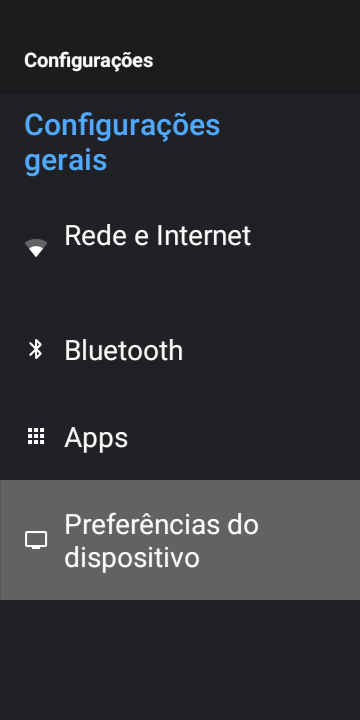
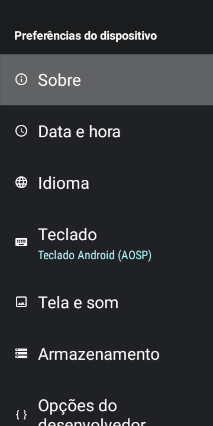
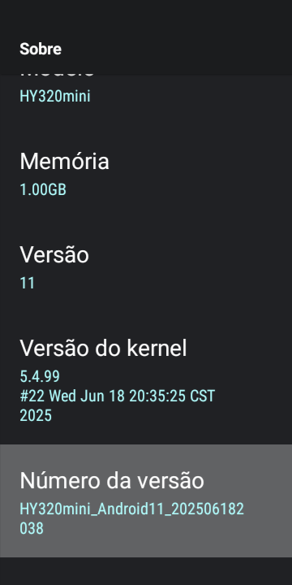
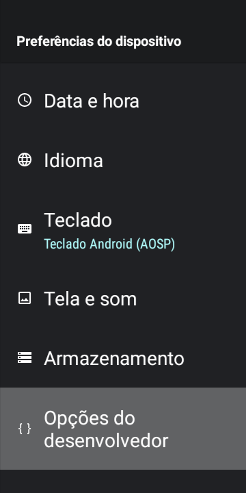
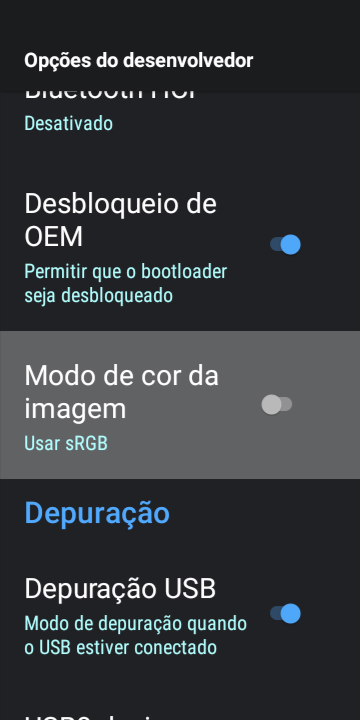
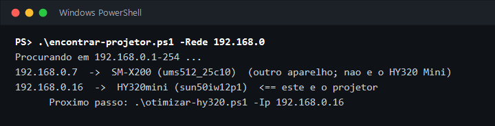
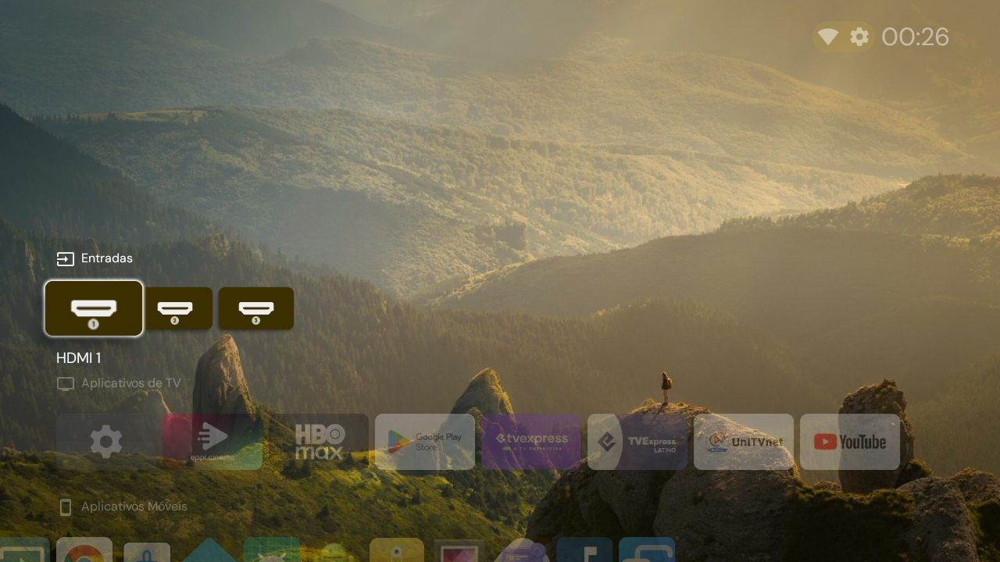

# Tutorial: deixando o HY320 Mini mais rápido

Este passo a passo é para quem nunca usou um terminal. Leva de 20 a 30 minutos, e a maior parte é espera.

Nada é apagado do projetor. Se não gostar do resultado, o [passo 9](#9-como-desfazer) desfaz tudo.

> **Prefere não digitar comandos?** Se você tem o Claude Code, ele faz este tutorial inteiro por você e só pede o que é no controle do projetor. Veja [Jeito mais fácil: com o Claude Code](README.md#jeito-mais-fácil-com-o-claude-code).

## O que você precisa

- Um projetor **HY320 Mini** ligado e conectado ao Wi‑Fi.
- Um computador com **Windows 10 ou 11** na mesma rede (Wi‑Fi ou cabo, no mesmo roteador).
- O controle remoto do projetor.

## 1. Baixe os arquivos

1. Nesta página do GitHub, clique no botão verde **Code** e depois em **Download ZIP**.
2. Abra a pasta **Downloads**, clique com o botão direito no arquivo ZIP e escolha **Extrair tudo**.
3. Abra a pasta extraída. Você deve ver arquivos como `otimizar-hy320.ps1`.

## 2. Abra o PowerShell dentro da pasta

O PowerShell é a tela preta (ou azul) onde se digitam comandos.

1. Com a pasta extraída aberta, clique na **barra de endereço** no topo da janela (onde aparece o caminho da pasta).
2. Apague o que estiver escrito, digite `powershell` e aperte **Enter**.

Vai abrir uma janela com um texto terminando em `>`. É ali que você vai colar os comandos deste tutorial.

Para colar um comando: copie daqui, clique na janela do PowerShell, aperte o **botão direito do mouse** e depois **Enter**.

## 3. Instale o ADB

O ADB é o programa oficial do Google que permite ao computador conversar com aparelhos Android.

Cole este comando e aperte Enter:

```powershell
winget install Google.PlatformTools
```

Se perguntar se você aceita os termos, digite `Y` e aperte Enter.

Os scripts deste tutorial já encontram o ADB recém-instalado sozinhos. Se quiser conferir a instalação, **feche o PowerShell e abra de novo** (repita o passo 2) e cole:

```powershell
adb version
```

Deve aparecer algo como `Android Debug Bridge version 1.0.41`. Se aparecer um erro dizendo que `adb` não é reconhecido, veja [Problemas comuns](#problemas-comuns).

## 4. Ative a depuração no projetor

Agora é no projetor, com o controle remoto.

**4.1.** Na tela inicial, abra **Configurações** (o ícone de engrenagem) e entre em **Preferências do dispositivo**.



**4.2.** Entre em **Sobre**, que é o primeiro item.



**4.3.** Desça até **Número da versão** e aperte **OK sete vezes seguidas**. Vai aparecer um aviso dizendo que você agora é um desenvolvedor.



**4.4.** Aperte **Voltar** uma vez. No fim da lista de Preferências do dispositivo apareceu um item novo: **Opções do desenvolvedor**. Entre nele.



**4.5.** Desça até **Depuração USB** e ligue a chave (ela fica azul).



Cuidado nessa tela: não mexa nas outras opções. Só a "Depuração USB" interessa.

## 5. Encontre o projetor na rede

De volta ao computador, no PowerShell, cole estes dois comandos, um de cada vez:

```powershell
Set-ExecutionPolicy -Scope Process Bypass -Force
```

```powershell
.\encontrar-projetor.ps1
```

O primeiro comando autoriza a execução dos scripts só nesta janela. Se você fechar o PowerShell, cole-o de novo ao reabrir.

O segundo procura o projetor. Na primeira vez, **olhe a tela do projetor**: vai aparecer a pergunta "Permitir depuração USB?". Marque **Sempre permitir deste computador** e escolha **OK**. Depois rode o comando de novo.

Quando der certo, aparece algo assim:

```text
Procurando em 192.168.0.1-254 ...
192.168.0.15  ->  HY320mini (sun50iw12p1)  <== este e o projetor
      Proximo passo: .\otimizar-hy320.ps1 -Ip 192.168.0.15
```

Se houver outro aparelho Android com a depuração ligada na sua rede (um celular ou tablet), ele aparece na lista marcado como "outro aparelho" e não é alterado:



Anote o número que aparece antes da seta, na linha do projetor. No exemplo é `192.168.0.15`; o seu pode ser diferente. Esse é o **IP do projetor**.

Se não encontrar nada, veja [Problemas comuns](#problemas-comuns).

## 6. Rode a otimização

Escolha **uma** das duas formas e troque `192.168.0.15` pelo IP do seu projetor.

**Básica**: só o que não tem contrapartida.

```powershell
.\otimizar-hy320.ps1 -Ip 192.168.0.15
```

**Completa**: a básica mais quatro mudanças, explicadas abaixo.

```powershell
.\otimizar-hy320.ps1 -Ip 192.168.0.15 -Completo
```

O que a completa faz a mais:

| Mudança | O que você ganha | O que você perde |
|---|---|---|
| Bloqueia anúncios pelo DNS | Menos anúncios e rastreamento em sites e apps, sem instalar nada | Não tira os anúncios do YouTube. As consultas de endereços passam pelo serviço AdGuard |
| Desativa a loja e os atualizadores do fabricante | Memória livre e nenhum app instalado sem você pedir | Atualizações do fabricante. A Play Store continua |
| Bluetooth inicia desligado | Memória livre | Precisa ligar nas Configurações quando for usar |
| Instala o Projectivy como tela inicial | Tela inicial mais organizada | Ela usa mais memória que a original |

Se quiser só uma parte, use as opções separadas no lugar de `-Completo`: `-BloquearAnuncios`, `-DesativarFabricante`, `-DesligarBluetooth`, `-InstalarProjectivy`. Por exemplo, para a básica mais o bloqueio de anúncios:

```powershell
.\otimizar-hy320.ps1 -Ip 192.168.0.15 -BloquearAnuncios
```

## 7. Espere terminar

Vão aparecer muitas linhas terminando em `Success`. Isso leva **pouco mais de 10 minutos**, e o projetor fica lento enquanto roda. Não desligue o projetor nem feche a janela.

Terminou quando aparecer:

```text
Concluido. Reinicie o projetor e, depois, desligue a Depuracao USB nas opcoes do desenvolvedor.
```

## 8. Reinicie e desligue a depuração

1. **Reinicie o projetor**: desligue e ligue de novo.
2. Se você instalou o Projectivy, ele abre uma tela de boas-vindas. Siga as instruções com o controle.

   

3. Volte em **Configurações > Preferências do dispositivo > Opções do desenvolvedor** e **desligue a Depuração USB**.

O último item é importante: com a depuração ligada, qualquer aparelho da sua rede consegue controlar o projetor.

Pronto. A diferença aparece ao navegar pelos menus e abrir os apps. No aparelho em que isto foi testado, o dono notou uma melhora de velocidade de 235%; os prints e as medições estão na seção [Resultado](README.md#resultado) do README.

## Extra: instalando apps de streaming

Isso se faz no próprio projetor, sem o computador.

1. Na tela inicial, abra a **Google Play Store**.
2. Procure o app pelo nome e escolha **Instalar**.

O que esperar neste modelo:

| App | Instala? |
|---|---|
| YouTube, HBO Max, Prime Video, Paramount+ | Sim, pela Google Play Store |
| Netflix | Não pela Play Store. Sim pela loja do fabricante, em versão antiga |
| Disney+ | Não. A Play Store mostra "Seu dispositivo não é compatível com esta versão" |

**Netflix.** A Play Store recusa, porque a Netflix só libera o app atual para aparelhos certificados pelo Google. Mas a loja do próprio fabricante do projetor (o ícone **Appstore**, que também pode aparecer como **Loja de Aplicativos**) tem uma versão antiga e original da Netflix, chamada "7.120_NetFlix":

1. Abra a **Appstore** do projetor. Ela pede para aceitar uma política de privacidade que avisa que coleta informações de uso; só continue se concordar.
2. Escolha **7.120_NetFlix** e depois **Transferir**. Em menos de um minuto o ícone da Netflix aparece.
3. Essa é a versão feita para celular, então a navegação pede o **modo mouse** do controle remoto, se o seu tiver esse botão.

Se você rodou a otimização **completa**, a Appstore foi desativada e não aparece. Nesse caso, faça a instalação da Netflix **antes** da otimização, ou veja no [README](README.md#netflix-pela-loja-do-fabricante) como reativar a loja por um instante.

**Disney+.** A versão atual exige um Android mais novo que o do projetor, e a loja do fabricante não tem o app. Baixar o arquivo de outros sites ou receber de alguém não resolveu no teste: o projetor recusou a instalação.

Para o Disney+, e para ter a Netflix atual com o controle normal, ligue um aparelho de streaming (Fire TV Stick, Chromecast e parecidos) na entrada **HDMI** do projetor.

Se aparecer **"Não foi possível instalar"**, escolha OK e tente de novo; costuma funcionar na segunda vez.

Depois de instalar apps novos, vale rodar a otimização mais uma vez (passo 6) para que eles também fiquem mais rápidos.

## 9. Como desfazer

Ligue a Depuração USB de novo (passo 4.5), abra o PowerShell na pasta (passo 2) e cole, trocando o IP:

```powershell
Set-ExecutionPolicy -Scope Process Bypass -Force
```

```powershell
.\restaurar-hy320.ps1 -Ip 192.168.0.15
```

Para também remover o Projectivy:

```powershell
.\restaurar-hy320.ps1 -Ip 192.168.0.15 -RemoverProjectivy
```

Depois reinicie o projetor e desligue a depuração.

## Problemas comuns

**"adb não é reconhecido como nome de cmdlet"**
O PowerShell foi aberto antes da instalação terminar. Feche e abra de novo. Se continuar, baixe o ADB direto do Google em <https://developer.android.com/tools/releases/platform-tools>, extraia o ZIP e copie os arquivos `adb.exe`, `AdbWinApi.dll` e `AdbWinUsbApi.dll` para a pasta dos scripts. Os scripts encontram o ADB ali sozinhos; nesse caso, pule a conferência com `adb version`.

**"winget não é reconhecido"**
Seu Windows não tem o instalador `winget`. Use o download direto do item acima.

**"a execução de scripts foi desabilitada neste sistema"**
Faltou o comando `Set-ExecutionPolicy -Scope Process Bypass -Force`. Cole-o e tente de novo. Ele vale só para a janela aberta.

**"Nenhum aparelho com a depuração ligada foi encontrado"**
- Confira se a Depuração USB está ligada (passo 4.5) e se o projetor está no Wi‑Fi.
- O computador e o projetor precisam estar no mesmo roteador.
- Se a sua casa tem dois roteadores ou um repetidor, o projetor pode estar em outra faixa de endereços. Veja o IP dele no projetor, em **Configurações > Rede e Internet**, clicando na rede conectada. Se o IP for, por exemplo, `192.168.0.15`, rode:

```powershell
.\encontrar-projetor.ps1 -Rede 192.168.0
```

**"aguardando autorização"**
O projetor está mostrando a pergunta "Permitir depuração USB?". Aceite na tela dele e rode o comando de novo.

**"ABORTADO: ... não é o HY320 Mini"**
O script encontrou outro aparelho Android (um celular ou tablet, por exemplo) ou uma versão diferente do projetor. Ele para de propósito, para não alterar o aparelho errado. Confira o IP.

Se a mensagem mostra `hardware='sun50iw12p1'` com outro modelo (por exemplo `HY300Pro`), é um projetor com o mesmo chip do HY320 Mini, mas com outro firmware que não foi testado. Se for mesmo o seu projetor e você quiser tentar, rode a otimização **básica** com `-AceitarModelo`:

```powershell
.\otimizar-hy320.ps1 -Ip 192.168.0.15 -AceitarModelo
```

Tudo continua reversível pelo passo 9. Pacotes que não existirem nesse firmware são só pulados, com um aviso em amarelo.

**O projetor ficou sem internet depois de ligar o bloqueio de anúncios**
O bloqueio depende de uma conexão segura com o serviço de DNS, e ela precisa da data certa no projetor. Primeiro confira a data e a hora em **Configurações > Preferências do dispositivo > Data e hora**. Se não resolver, rode o `restaurar-hy320.ps1` (passo 9): ele desliga o bloqueio e funciona mesmo com o projetor sem internet, porque usa só a rede da sua casa.

**"O DNS privado não validou nesta rede"**
Sua rede ou operadora bloqueia esse tipo de conexão. O script já desfez a mudança sozinho; o restante da otimização foi aplicado normalmente.

**Algum botão do controle parou de funcionar ou algo ficou estranho**
Rode o `restaurar-hy320.ps1` (passo 9). Ele volta tudo ao estado original.

**O projetor trocou de IP**
Acontece depois de alguns dias. Rode o `encontrar-projetor.ps1` de novo para ver o IP atual.
