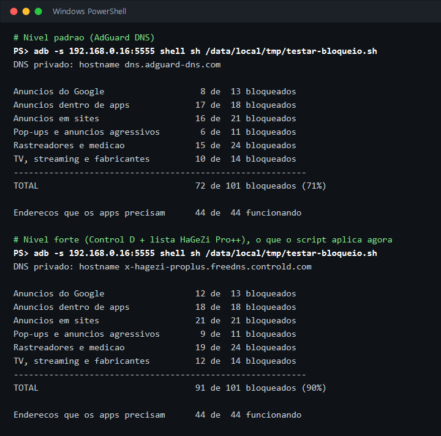
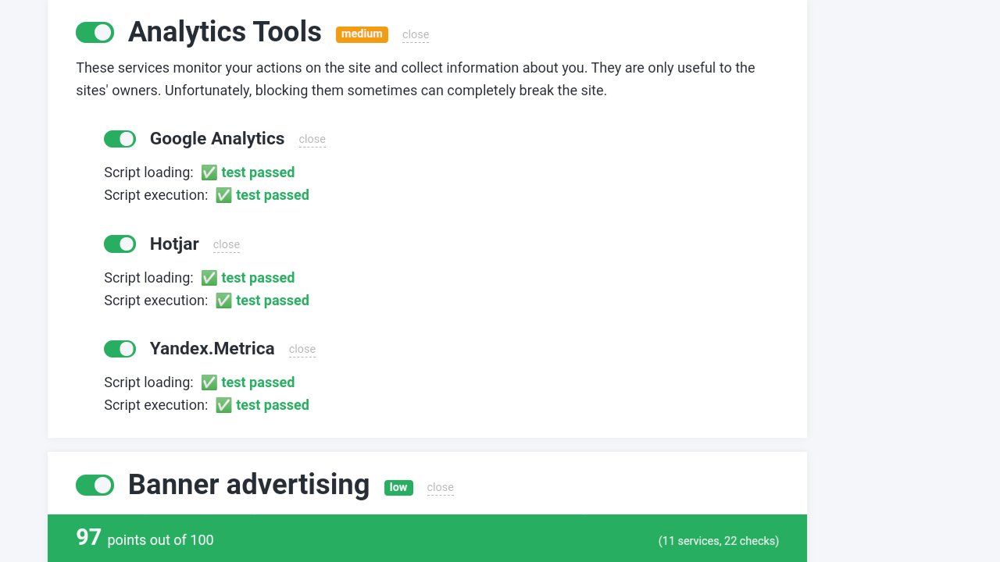

# Bloqueio de anúncios no projetor: o que existe e o que foi adotado

Este documento explica como o navegador Brave bloqueia anúncios, quais outros métodos existem, o que cada um consegue fazer em um projetor Android de 1 GB sem root, e o que este repositório aplica. Os números são de medições feitas em 12 de novembro de 2026 em um HY320 Mini.

## Resumo

Nenhum método sozinho bloqueia tudo. O que funciona é somar camadas, cada uma cobrindo o que a outra não alcança:

| Camada | O que cobre | Como é aplicada | Custo no projetor |
|---|---|---|---|
| 1. DNS com filtro forte | Todos os apps e o sistema | `otimizar-hy320.ps1 -BloquearAnuncios` | Nenhum (o filtro roda no servidor) |
| 2. Navegador com bloqueador | Páginas da internet | TV Bro, instalado pela Play Store do projetor | Só enquanto o navegador está aberto |
| 3. App do YouTube sem anúncios | YouTube | Fora deste repositório (veja [YouTube](#youtube)) | |

Resultado medido no projetor:

- **Camada 1:** 91 de 101 endereços de anúncio e rastreamento bloqueados (eram 72 com o serviço usado antes), e os 44 endereços de que os apps precisam continuaram funcionando.
- **Camadas 1 e 2 juntas:** 97 de 100 pontos na página [AdBlock Tester](https://adblock-tester.com/), aberta no TV Bro.

O que continua aparecendo: os anúncios do app do YouTube e os intervalos comerciais dos planos "com anúncios" de Netflix, Prime Video e HBO Max. A seção [O que ninguém bloqueia](#o-que-ninguém-bloqueia) explica por quê.

## Como o Brave bloqueia

O Brave é um navegador com o bloqueador embutido (o "Shields"). O bloqueador é uma biblioteca própria, a [adblock-rust](https://github.com/brave/adblock-rust), que fica dentro do navegador e trabalha em quatro frentes:

1. **Filtro de rede.** O navegador carrega listas de filtros (EasyList, EasyPrivacy, as listas do uBlock Origin e as do próprio Brave), com dezenas de milhares de regras. Antes de cada pedido sair, ele confere o endereço completo, o tipo do arquivo (imagem, script, vídeo) e de qual site o pedido partiu. Se bate com uma regra, o pedido nem é feito.
2. **Filtro cosmético.** Depois que a página carrega, ele esconde o que sobrou: caixas vazias, faixas "Publicidade", avisos pedindo para desligar o bloqueador.
3. **Scriptlets.** Pequenos trechos de código injetados na página para neutralizar scripts de anúncio que não podem ser simplesmente bloqueados sem quebrar o site, e os que detectam bloqueador.
4. **Desmascarar apelidos (CNAME).** Alguns rastreadores se escondem atrás de um endereço que parece ser do próprio site (`metricas.loja.com`, que na verdade aponta para a empresa de rastreamento). O Brave consulta o nome verdadeiro e [aplica as regras aos dois](https://brave.com/privacy-updates-6/).

No modo padrão, o Brave bloqueia pedidos a terceiros; no modo agressivo, também os pedidos ao próprio site visitado ([política de bloqueio](https://github.com/brave/brave-browser/wiki/Blocking-goals-and-policy)).

**Por que isso só funciona dentro do navegador.** As quatro frentes dependem de enxergar o endereço completo de cada pedido e o conteúdo da página. O navegador enxerga porque é ele quem faz o pedido e monta a página. De fora, a conversa de qualquer outro app com a internet é criptografada: dá para ver com qual servidor ele fala, e nada mais. Por isso não existe "Brave para o sistema inteiro".

**O Brave no projetor.** A Play Store do HY320 Mini recusa o Brave: "Seu dispositivo não é compatível com esta versão". O navegador que vem de fábrica é um Chrome de 2019 (versão 75), sem bloqueador.

## Os métodos que existem

| Método | Onde age | O que enxerga | Custo em um aparelho de 1 GB | Aqui |
|---|---|---|---|---|
| DNS com filtro (DNS privado do Android) | Sistema inteiro | Só o nome do servidor | Nenhum | **Adotado** |
| Navegador com bloqueador | Páginas abertas nele | Endereço completo e a página | Só com o navegador aberto | **Adotado** (TV Bro) |
| App alternativo de YouTube | YouTube | Tudo, é o próprio app | Igual ao app oficial | Decisão de quem usa |
| App bloqueador com VPN local (AdGuard, RethinkDNS, Blokada, DNS66) | Sistema inteiro | Só o nome do servidor, como o DNS | Um serviço sempre ligado, usando memória e processador | Não adotado |
| Arquivo `hosts` | Sistema inteiro | Só o nome do servidor | Nenhum | Exige root; não adotado |
| Filtro no roteador (AdGuard Home, Pi-hole, ou o DNS com filtro configurado no roteador) | A casa inteira | Só o nome do servidor | Nenhum no projetor | Opcional, fora do projetor |
| Abrir a criptografia dos apps (certificado próprio) | Sistema inteiro | Tudo | Alto | Inviável: desde o Android 7 os apps recusam certificados instalados pelo usuário |

Por que o app bloqueador com VPN local ficou de fora: fora do navegador ele enxerga o mesmo que o DNS com filtro (o nome do servidor), então bloqueia praticamente a mesma coisa, mas mantém um serviço permanente em um aparelho que tem 954 MB de RAM. O objetivo deste repositório é deixar o projetor mais rápido; trocar memória livre por um bloqueio que o DNS já faz de graça não compensa.

## Camada 1: DNS com filtro forte

Todo app, antes de falar com um servidor, pergunta o endereço dele a um serviço de DNS. Um DNS com filtro responde "não existe" para os servidores de anúncio. O Android 9 em diante tem isso embutido (**DNS privado**), sem instalar nada.

A força do bloqueio depende da lista que o serviço usa. Foram comparados serviços gratuitos que funcionam com o DNS privado do Android (a tabela mostra os onze principais), com os mesmos 101 endereços de anúncio e rastreamento (todos existentes, conferidos em um DNS sem filtro) e 48 endereços que precisam continuar funcionando:

| Serviço | Bloqueados (de 101) | Necessários quebrados | Tempo de resposta |
|---|---|---|---|
| AdGuard DNS (o usado até a versão anterior) | 72 | 0 | 10 ms |
| Tiarap | 68 | 0 | 339 ms |
| Control D + lista OISD | 75 | 0 | 11 ms |
| Control D + HaGeZi Pro | 82 | 0 | 11 ms |
| Mullvad DNS (base) | 86 | 0 | 195 ms |
| Control D "ads & tracking" | 89 | 0 | 11 ms |
| BlahDNS | 91 | 0 | 189 ms |
| **Control D + HaGeZi Pro++** (nível `forte`) | **93** | **0** | **11 ms** |
| DNSForge | 93 | 0 | 207 ms |
| **Control D + HaGeZi Ultimate** (nível `maximo`) | **95** | **0** | **11 ms** |
| DNSForge Hard | 95 | 0 | 222 ms |

Essa comparação foi feita a partir do PC, na mesma internet do projetor. Os serviços com tempo perto de 200 ms não têm servidor no Brasil; cada endereço novo que o projetor consulta esperaria esse tempo, por isso ficaram de fora.

Os três níveis do script:

| `-NivelBloqueio` | Serviço | Observação |
|---|---|---|
| `forte` (padrão) | `x-hagezi-proplus.freedns.controld.com` | Medido no projetor: 91 de 101, nenhum endereço necessário quebrado; YouTube, Netflix, Prime Video, HBO Max e Paramount+ abriram normalmente |
| `maximo` | `x-hagezi-ultimate.freedns.controld.com` | Bloqueia também os endereços do "Entrar com Facebook" e pode quebrar um ou outro site. Só a comparação pelo PC foi feita |
| `padrao` | `dns.adguard-dns.com` | 72 de 101. O mais conservador; use se algum app parar de funcionar com os outros |

O que o nível `forte` deixa passar, e por quê:

- `imasdk.googleapis.com`: é o componente de anúncios em vídeo do Google. As listas não o bloqueiam porque vários apps de vídeo travam sem ele.
- `graph.facebook.com` e `connect.facebook.net`: usados para rastreamento e também pelo "Entrar com Facebook". O nível `maximo` bloqueia os dois.
- `appsflyer.com`, `app.adjust.com`, `analytics.twitter.com` e alguns outros: medição de uso. Na comparação pelo PC, `app.adjust.com` aparece bloqueado; no projetor ainda passava, provavelmente por resposta guardada do serviço anterior.

Para medir no seu aparelho: [ferramentas/testar-bloqueio.sh](../ferramentas/testar-bloqueio.sh). O teste não altera nada e leva de 1 a 3 minutos. Depois de trocar de nível, espere alguns minutos antes de medir: o Android guarda respostas antigas por um tempo.

O que saber:

- **Privacidade.** As consultas de endereços do projetor passam a ir para o serviço escolhido ([Control D](https://controld.com/free-dns), do Canadá, ou [AdGuard](https://adguard-dns.io/)) em vez da sua operadora. Os dois afirmam não guardar registro das consultas no serviço gratuito.
- **Dependência.** Se o serviço sair do ar, o projetor fica sem internet até o DNS privado ser desligado. O `restaurar-hy320.ps1` faz isso pela rede local, sem precisar de internet.
- **Lista de terceiros.** A lista HaGeZi é mantida por voluntários e o endereço que a aplica é um recurso gratuito do Control D. Se um dia ele mudar, rode o script de novo com `-NivelBloqueio padrao`.

## Camada 2: navegador com bloqueador

Para páginas da internet, o bloqueio por DNS deixa sobras: caixas vazias no lugar do anúncio e anúncios servidos pelo próprio site. É aí que entra o método do Brave, o filtro dentro do navegador.

Como o Brave não instala neste projetor, o escolhido foi o **[TV Bro](https://github.com/truefedex/tv-bro)** (`com.phlox.tvwebbrowser`):

- está na Play Store do projetor e instala normalmente (versão 2.1.6 no teste);
- é de código aberto e foi feito para controle remoto, com um cursor movido pelas setas;
- tem bloqueador de anúncios por lista de filtros, já ligado na primeira abertura (o botão **ads ON** na barra de baixo);
- não fica rodando em segundo plano.

Com o DNS no nível `forte` e o TV Bro, a página AdBlock Tester deu 97 de 100 pontos:

Limites: o TV Bro usa o motor de páginas do próprio Android do projetor, que é de 2020 (WebView 83), então alguns sites recentes podem aparecer desalinhados. E o bloqueador dele é mais simples que o do Brave; o funcionamento interno não foi analisado aqui, só o resultado.

Para instalar: abra a Play Store no projetor, procure por "TV Bro" e escolha **Instalar**. Pelo Claude Code, basta pedir; a skill `configurar-projetor` faz isso.

## YouTube

Os anúncios do app do YouTube vêm dos mesmos servidores dos vídeos. Bloquear o servidor bloqueia o vídeo junto, então DNS, VPN local e `hosts` não resolvem.

O que resolve é um app alternativo de YouTube para TV, como o SmartTube, que simplesmente não pede os anúncios. Ele não está na Play Store: é baixado do site do desenvolvedor. A regra deste repositório é não baixar apps de fora da Play Store por conta própria, então o script não o instala. Quem quiser instala por decisão própria, sabendo que é um app não oficial, que o YouTube pode bloqueá-lo a qualquer momento e que entrar com a conta Google nele é um risco a pesar.

A alternativa oficial é o YouTube Premium.

## O que ninguém bloqueia

- **Planos de streaming com anúncios** (Netflix, Prime Video, HBO Max). O intervalo comercial é costurado no próprio vídeo, no servidor. Para o projetor, é um vídeo só.
- **Conteúdo patrocinado dentro de um app**, entregue pelo mesmo servidor do conteúdo.
- **Anúncios do app oficial do YouTube**, pelo motivo acima.

## Como desfazer

- DNS: `.\restaurar-hy320.ps1 -Ip <ip>` desliga o DNS privado, ou rode o `otimizar-hy320.ps1` com outro `-NivelBloqueio`.
- TV Bro: desinstale pelas Configurações do projetor, em **Apps**.

## Fontes

- [brave/adblock-rust](https://github.com/brave/adblock-rust): o motor de bloqueio do Brave.
- [Blocking goals and policy](https://github.com/brave/brave-browser/wiki/Blocking-goals-and-policy): modos padrão e agressivo.
- [Fighting CNAME trickery](https://brave.com/privacy-updates-6/): como o Brave desmascara apelidos.
- [truefedex/tv-bro](https://github.com/truefedex/tv-bro): o navegador TV Bro.
- [hagezi/dns-blocklists](https://github.com/hagezi/dns-blocklists): as listas HaGeZi.
- [Control D Free DNS](https://controld.com/free-dns) e [AdGuard DNS](https://adguard-dns.io/).
