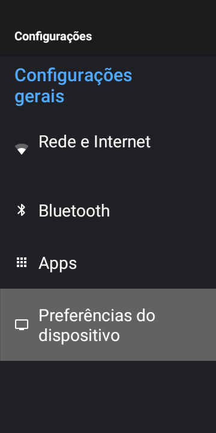
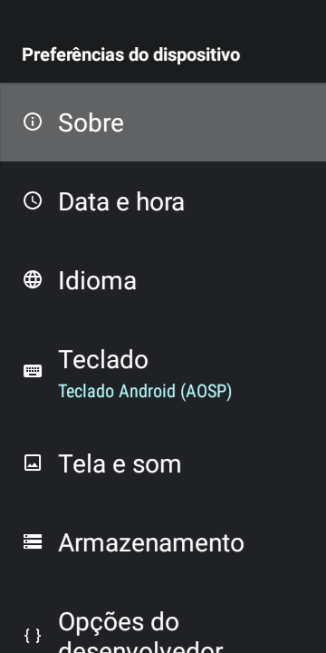
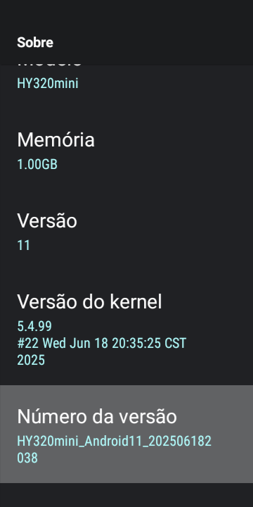
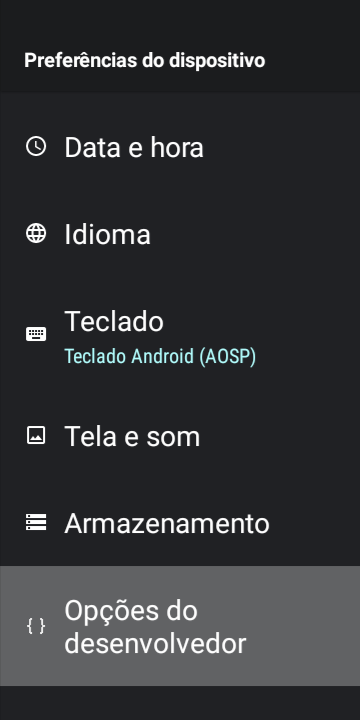
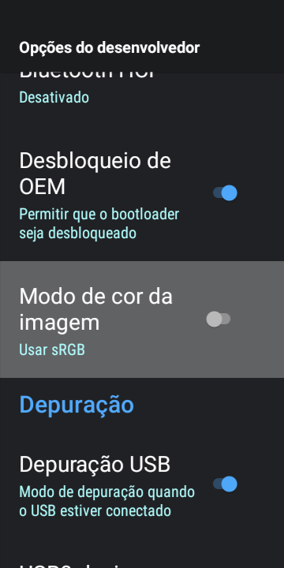
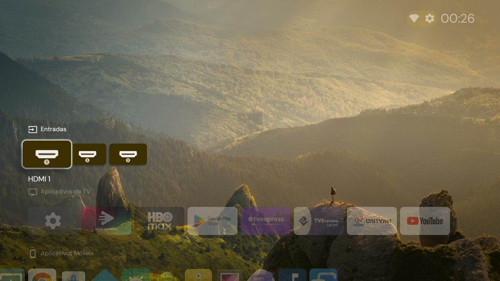

# Tutorial para Mac: deixando o HY320 Mini mais rápido

Esta é a versão do [tutorial](../TUTORIAL.md) para quem usa **Mac**. Ela é para quem nunca usou um terminal. Leva de 20 a 30 minutos, e a maior parte é espera.

Nada é apagado do projetor. Se não gostar do resultado, o [passo 9](#9-como-desfazer) desfaz tudo.

> No Mac, tudo acontece dentro da pasta **`mac`**, onde estão os scripts terminados em **`.sh`** (`encontrar-projetor.sh`, `otimizar-hy320.sh`, `restaurar-hy320.sh`). Os arquivos `.ps1`, fora dela, são só para Windows e podem ser ignorados.

## O que você precisa

- Um projetor **HY320 Mini** ligado e conectado ao Wi‑Fi.
- Um **Mac** (com chip Apple ou Intel) na mesma rede (Wi‑Fi ou cabo, no mesmo roteador).
- O controle remoto do projetor.

## 1. Baixe os arquivos

1. Nesta página do GitHub, clique no botão verde **Code** e depois em **Download ZIP**.
2. Abra a pasta **Downloads** no Finder. O Safari costuma extrair o ZIP sozinho; se você ainda vir só o arquivo `.zip`, dê **dois cliques** nele.
3. Abra a pasta extraída e, dentro dela, a pasta **`mac`**. Você deve ver arquivos como `otimizar-hy320.sh`.

## 2. Abra o Terminal dentro da pasta

O Terminal é a janela onde se digitam comandos.

1. Aperte **Command (⌘) + Espaço**, digite `Terminal` e aperte **Enter**.
2. Na janela do Terminal, digite `cd` seguido de **um espaço** (não aperte Enter ainda).
3. **Arraste a pasta `mac`** (a que fica dentro da pasta extraída) do Finder para dentro da janela do Terminal. O caminho da pasta aparece escrito sozinho.
4. Aperte **Enter**.

O texto antes do cursor deve terminar com `mac %`. É ali que você vai colar os comandos deste tutorial.

Para colar um comando: copie daqui, clique na janela do Terminal, aperte **Command (⌘) + V** e depois **Enter**.

Se você fechar o Terminal, repita este passo ao abrir de novo.

## 3. Instale o ADB

O ADB é o programa oficial do Google que permite ao computador conversar com aparelhos Android.

Cole este comando e aperte Enter. Ele baixa o ADB direto do site do Google para dentro da pasta `mac`:

```bash
curl -O https://dl.google.com/android/repository/platform-tools-latest-darwin.zip && unzip -q platform-tools-latest-darwin.zip && rm platform-tools-latest-darwin.zip
```

Para conferir, cole:

```bash
./platform-tools/adb version
```

Deve aparecer algo como `Android Debug Bridge version 1.0.41`. Os scripts encontram o ADB nessa pasta sozinhos.

> **Já usa Homebrew?** Pode instalar com `brew install --cask android-platform-tools` no lugar do comando acima. Os scripts também encontram o ADB instalado assim.

## 4. Ative a depuração no projetor

Agora é no projetor, com o controle remoto.

**4.1.** Na tela inicial, abra **Configurações** (o ícone de engrenagem) e entre em **Preferências do dispositivo**.



**4.2.** Entre em **Sobre**, que é o primeiro item.



**4.3.** Desça até **Número da versão** e aperte **OK sete vezes seguidas**. Vai aparecer um aviso dizendo que você agora é um desenvolvedor.



**4.4.** Aperte **Voltar** uma vez. No fim da lista de Preferências do dispositivo apareceu um item novo: **Opções do desenvolvedor**. Entre nele.



**4.5.** Desça até **Depuração USB** e ligue a chave (ela fica azul).



Cuidado nessa tela: não mexa nas outras opções. Só a "Depuração USB" interessa.

## 5. Encontre o projetor na rede

De volta ao Mac, no Terminal, cole:

```bash
bash encontrar-projetor.sh
```

Dois avisos podem aparecer na primeira vez:

- **No Mac:** "“Terminal” deseja encontrar e se conectar a dispositivos na sua rede local". Clique em **Permitir**. Depois rode o comando de novo.
- **Na tela do projetor:** "Permitir depuração USB?". Marque **Sempre permitir deste computador** e escolha **OK**. Depois rode o comando de novo.

Quando der certo, aparece algo assim:

```text
Procurando em 192.168.0.1-254 ...
192.168.0.15  ->  HY320mini (sun50iw12p1)  <== este e o projetor
      Proximo passo: bash otimizar-hy320.sh --ip 192.168.0.15
```

Se houver outro aparelho Android com a depuração ligada na sua rede (um celular ou tablet), ele aparece na lista marcado como "outro aparelho" e não é alterado.

Anote o número que aparece antes da seta, na linha do projetor. No exemplo é `192.168.0.15`; o seu pode ser diferente. Esse é o **IP do projetor**.

Se não encontrar nada, veja [Problemas comuns](#problemas-comuns).

## 6. Rode a otimização

Escolha **uma** das duas formas e troque `192.168.0.15` pelo IP do seu projetor.

**Básica**: só o que não tem contrapartida.

```bash
bash otimizar-hy320.sh --ip 192.168.0.15
```

**Completa**: a básica mais quatro mudanças, explicadas abaixo.

```bash
bash otimizar-hy320.sh --ip 192.168.0.15 --completo
```

O que a completa faz a mais:

| Mudança | O que você ganha | O que você perde |
|---|---|---|
| Bloqueia anúncios pelo DNS | Menos anúncios e rastreamento em sites e apps, sem instalar nada | Não tira os anúncios do YouTube. As consultas de endereços passam pelo serviço AdGuard |
| Desativa a loja e os atualizadores do fabricante | Memória livre e nenhum app instalado sem você pedir | Atualizações do fabricante. A Play Store continua |
| Bluetooth inicia desligado | Memória livre | Precisa ligar nas Configurações quando for usar |
| Instala o Projectivy como tela inicial | Tela inicial mais organizada | Ela usa mais memória que a original |

Se quiser só uma parte, use as opções separadas no lugar de `--completo`: `--bloquear-anuncios`, `--desativar-fabricante`, `--desligar-bluetooth`, `--instalar-projectivy`. Por exemplo, para a básica mais o bloqueio de anúncios:

```bash
bash otimizar-hy320.sh --ip 192.168.0.15 --bloquear-anuncios
```

## 7. Espere terminar

Vão aparecer muitas linhas terminando em `Success`. Isso leva **pouco mais de 10 minutos**, e o projetor fica lento enquanto roda. Não desligue o projetor, não feche o Terminal e não deixe o Mac entrar em repouso (deixe a tampa aberta, se for um notebook).

Terminou quando aparecer:

```text
Concluido. Reinicie o projetor e, depois, desligue a Depuracao USB nas opcoes do desenvolvedor.
```

## 8. Reinicie e desligue a depuração

1. **Reinicie o projetor**: desligue e ligue de novo.
2. Se você instalou o Projectivy, ele abre uma tela de boas-vindas. Siga as instruções com o controle.

   

3. Volte em **Configurações > Preferências do dispositivo > Opções do desenvolvedor** e **desligue a Depuração USB**.

O último item é importante: com a depuração ligada, qualquer aparelho da sua rede consegue controlar o projetor.

Pronto. A diferença aparece ao navegar pelos menus e abrir os apps. Os prints e as medições estão na seção [Resultado](../README.md#resultado) do README.

## Extra: instalando apps de streaming

Isso se faz no próprio projetor, sem o computador, e é igual para quem usa Windows ou Mac. Veja a seção [Extra: instalando apps de streaming](../TUTORIAL.md#extra-instalando-apps-de-streaming) do tutorial original.

Depois de instalar apps novos, vale rodar a otimização mais uma vez (passo 6) para que eles também fiquem mais rápidos.

## 9. Como desfazer

Ligue a Depuração USB de novo (passo 4.5), abra o Terminal na pasta (passo 2) e cole, trocando o IP:

```bash
bash restaurar-hy320.sh --ip 192.168.0.15
```

Para também remover o Projectivy:

```bash
bash restaurar-hy320.sh --ip 192.168.0.15 --remover-projectivy
```

Depois reinicie o projetor e desligue a depuração.

Se a otimização foi feita num PC com Windows, o restaurar do Mac também funciona: copie a pasta `backup` criada no Windows (que fica ao lado dos arquivos `.ps1`) para dentro da pasta `mac`.

## Problemas comuns

**"ADB nao encontrado"** ou **"command not found: adb"**
O passo 3 não terminou ou foi feito em outra pasta. Confira se existe uma pasta `platform-tools` dentro da pasta `mac`. Se não existir, repita o passo 2 e depois o passo 3.

**"No such file or directory"**
O Terminal não está dentro da pasta `mac`. Repita o passo 2.

**"zsh: permission denied"**
O comando foi digitado como `./otimizar-hy320.sh`. Use sempre `bash` na frente: `bash otimizar-hy320.sh ...`.

**"“adb” não pode ser aberto porque o desenvolvedor não pode ser verificado"**
Acontece quando o ADB foi baixado pelo navegador em vez do comando do passo 3. Cole este comando na pasta `mac` e tente de novo:

```bash
xattr -dr com.apple.quarantine platform-tools
```

**"Nenhum aparelho com a depuracao ligada foi encontrado"**
- Confira se a Depuração USB está ligada (passo 4.5) e se o projetor está no Wi‑Fi.
- O Mac e o projetor precisam estar no mesmo roteador.
- No macOS 15 (Sequoia) ou mais novo, o Terminal precisa de permissão para a rede local. Abra **Ajustes do Sistema > Privacidade e Segurança > Rede Local** e ligue a chave do **Terminal**. Feche e abra o Terminal e repita o passo 2.
- Se você usa VPN, desligue-a enquanto faz o tutorial.
- Se a sua casa tem dois roteadores ou um repetidor, o projetor pode estar em outra faixa de endereços. Veja o IP dele no projetor, em **Configurações > Rede e Internet**, clicando na rede conectada. Se o IP for, por exemplo, `192.168.0.15`, rode:

```bash
bash encontrar-projetor.sh --rede 192.168.0
```

**"aguardando autorizacao"**
O projetor está mostrando a pergunta "Permitir depuração USB?". Aceite na tela dele e rode o comando de novo.

**"ABORTADO: ... nao e o HY320 Mini"**
O script encontrou outro aparelho Android (um celular ou tablet, por exemplo) ou uma versão diferente do projetor. Ele para de propósito, para não alterar o aparelho errado. Confira o IP.

Se a mensagem mostra `hardware='sun50iw12p1'` com outro modelo (por exemplo `HY300Pro`), é um projetor com o mesmo chip do HY320 Mini, mas com outro firmware que não foi testado. Se for mesmo o seu projetor e você quiser tentar, rode a otimização **básica** com `--aceitar-modelo`:

```bash
bash otimizar-hy320.sh --ip 192.168.5.251 --aceitar-modelo
```

Tudo continua reversível pelo passo 9. Pacotes que não existirem nesse firmware são só pulados, com um aviso em amarelo.

**O projetor ficou sem internet depois de ligar o bloqueio de anúncios**
O bloqueio depende de uma conexão segura com o serviço de DNS, e ela precisa da data certa no projetor. Primeiro confira a data e a hora em **Configurações > Preferências do dispositivo > Data e hora**. Se não resolver, rode o `restaurar-hy320.sh` (passo 9): ele desliga o bloqueio e funciona mesmo com o projetor sem internet, porque usa só a rede da sua casa.

**"O DNS privado nao validou nesta rede"**
Sua rede ou operadora bloqueia esse tipo de conexão. O script já desfez a mudança sozinho; o restante da otimização foi aplicado normalmente.

**Algum botão do controle parou de funcionar ou algo ficou estranho**
Rode o `restaurar-hy320.sh` (passo 9). Ele volta tudo ao estado original.

**O projetor trocou de IP**
Acontece depois de alguns dias. Rode o `encontrar-projetor.sh` de novo para ver o IP atual.
